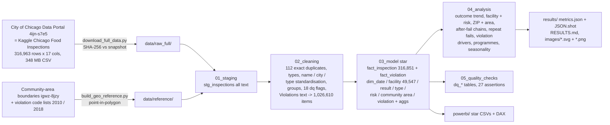
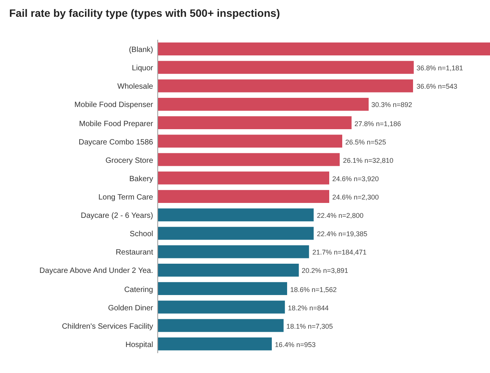

# da-learn-26 · Chicago food inspections (2010 - Oct 2026)

A data-analyst learning project on the real **City of Chicago Food Inspections** dataset, the inspection reports of the Chicago Department
of Public Health's Food Protection Program (also on Kaggle as *Chicago Food Inspections*): **316,963 raw rows x 17 columns (348 MB of CSV),
every restaurant, grocery, school, daycare and other food-establishment inspection from 4 January 2010 to 9 October 2026**. The project
asks what a city food-safety team would ask: how often places fail, which kinds of places and neighbourhoods fail most, whether failed
places get fixed, and which violations actually drive a Fail.

The cleaning problems are real ones: duplicate reports with a different Inspection ID, a free-text `Violations` column that packs every
cited item (`NN. TITLE - Comments: ...`, separated by ` | `) into one cell, a **code list that changed on 1 July 2018** (the new Chicago Food Code form reuses
the same numbers for different violations), 110 inspection-type and 527 facility-type spellings, "CCHICAGO" / "312CHICAGO"-style city typos,
Risk `All`, blank licences, reports that are not inspections at all (Out of Business, No Entry, Not Ready), and no neighbourhood column in the
export (community areas are assigned here by point-in-polygon). DuckDB runs the whole SQL pipeline locally on the **full** data in under
10 seconds. The outputs are a Power BI kit plus 21 charts and a dashboard as SVG and PNG in `results/images/`.

> **Databricks was skipped** for this project because the Databricks workspace hit its resource quota. There is no live Lakeview dashboard. The
> SQL stays Databricks/Spark-compatible (the DuckDB shims are isolated in `sql/00`), and all charts and KPIs are in [`results/`](results/RESULTS.md).


## Business questions
1. What share of inspections Pass, Pass with Conditions or Fail, and how has that changed since 2010 (and with the 2018 Food Code form)?
2. Which facility types and risk categories fail most?
3. Which ZIP codes and community areas have the highest fail rates (minimum-volume thresholds), and is that just the inspection mix?
4. Do re-inspections after a Fail pass, how fast do they happen, and how often do facilities fail repeatedly?
5. Which violation themes, codes and severity levels (Critical / Serious / Minor, Priority / Priority foundation / Core) drive failures?
6. How do canvass (routine), complaint, licence, food-poisoning and task-force inspections differ?
7. How clean is the raw export (duplicates, missing geo, out-of-city addresses, non-outcomes, text quirks), and what had to be fixed?

## Pipeline


## Headline insights (full data, 272,061 completed inspections)
1. **About one completed inspection in five fails, and that rate has barely moved in 16 years.** Of 272,061 completed inspections (2010-01-04 to 2026-10-09), 60.29% passed, 17.27% passed with conditions and 22.43% failed. Yearly fail rates stay between 19.62% and 25.91% (25.91% in 2010, 21.12% in 2025). What changed is the middle category: the new Food Code form of 1 July 2018 moved inspections from Pass to Pass w/ Conditions (2019: 28.33% pass, 49.26% with conditions), and the conditions share has since eased back to 14.2% (2025). Before vs after the switch: fail 22.18% vs 22.75%, conditions 10.93% vs 25.21%.
2. **The first visit is the risky one.** License inspections of new businesses fail 33.98%, complaint inspections 29.94%, routine canvass visits 22.62%, while re-inspections fail only 9.77%. Liquor task-force sweeps fail 56.85% (n = 920).
3. **Facility type matters more than the official risk category.** Bars, taverns and liquor stores fail 36.46%, wholesale / shared kitchens 28.71%, grocery and convenience stores 26.19%, restaurants 21.72%, and catering & banquet the least (19.39%). By risk category the order is reversed: Risk 1 (High) fails 21.83%, Risk 3 (Low) 29.05%. High-risk places are inspected far more often (7.85 completed inspections per facility vs 2.14); a likely reason for the reversal is that frequent routine visits keep high-risk kitchens prepared, while low-risk places are seen rarely.
4. **A clear South and West Side gap.** Among the 74 community areas with 500+ completed inspections, the fail rate runs from 33.52% in Washington Park and 30.78% in Greater Grand Crossing to 14.48% in Clearing and 13.35% at O’Hare. Of 57 ZIP codes with 1,000+ inspections, 60619 is highest (29.75%) and 60666 (O'Hare airport) lowest (12.39%). It is not just more complaint visits: the area fail rate tracks the fail rate of routine canvass visits (correlation 0.95; canvass fail rates range 12.27%-41.2%) more closely than the complaint share (0.533).
5. **Fails are usually fixed fast, but failure repeats.** 84.34% of fails get a follow-up within 14 days (median 7 days), and the next completed inspection passes 76.78% of the time (plus 11.49% with conditions); 11.73% fail again. Over the whole period 58.97% of inspected facilities failed at least once, 50.60% of those failed again, and 3,135 facilities (7.1%) failed five or more times, together 21,831 fails (35.8% of all fails).
6. **Pests, hand-wash sinks and serious-risk citations decide the outcome.** On the 2018 form an inspection with a Priority violation fails 59.12% of the time (the rest pass with conditions) and one with a Priority-foundation violation 43.08%, while core-only inspections fail 1.58%. Code 38 (insects, rodents and animals) appears in 47.08% of failed inspections vs 7.21% of passes, and 64.06% of inspections citing it fail; on the 2010 form code 18 (rodent proofing / pest log) was in 48.95% of fails and 97.49% of inspections citing it failed. Fail rates rise steadily with the number of violations (2018 form: 3.5% with none, 28.47% with five, 67.46% with 12 or more).
7. **Late summer is worst.** In full years 2010-2025 the fail rate peaks in Aug (24.09%) and is lowest in Dec (19.9%); the share of inspections citing pests rises from 11.95% (Dec) to 15.67% (Aug) and complaint-driven visits peak in July-August.
8. **Cleaning mattered.** 316,963 raw rows -> 316,851 distinct reports (112 exact duplicates with a different Inspection ID). 44,790 reports (Out of Business, No Entry, Not Ready, Business Not Located) are not inspection outcomes and are kept out of every rate. 3,647 fails carry no violation text, 1,061 reports have no coordinates, 118 city spellings of CHICAGO were fixed, and the Violations free text was split into 1,026,610 coded items joined to the right code list (2010 or 2018 form). 27/27 assertions pass.

Full tables, all insights and the data-quality evidence are in [`results/RESULTS.md`](results/RESULTS.md).

## Charts
All charts are in `results/images/` as SVG (plain vector shapes, no embedded raster) and PNG (2x headless-Chrome render of the same SVG).
The dashboard is [`dashboard.svg`](results/images/dashboard.svg) / [`dashboard.png`](results/images/dashboard.png).

| | |
|---|---|
|  |  |
|  |  |
|  |  |
|  |  |
|  |  |
|  |  |
|  |  |
|  |  |
|  |  |
|  |  |
|  | |

**How the images were made:** `scripts/make_charts.py` reads the DuckDB query results exported to `results/tables/*.csv` and writes each chart
as a plain-vector SVG with the small custom writer `scripts/svgcharts.py` (rect/line/polyline/polygon/circle/text only, no plotting library).
The community-area map draws the 77 official boundaries as SVG polygons and the grid map is a longitude/latitude scatter (no basemap).
`scripts/render_png.py` then rasterises every SVG to PNG at 2x with headless Google Chrome.

## How to run
```bash
pip install -r requirements.txt
python run_pipeline.py --source sample          # committed raw sample in data/raw/ (7,500 rows, 8.0 MB) -> results/sample/
python scripts/download_full_data.py --geo      # 348 MB CSV (+ 2.1 MB community-area GeoJSON) -> data/raw_full/
python run_pipeline.py --source full            # full data (~8 s of SQL): results/, data/clean/, powerbi/data/, RESULTS.md, SVGs
python scripts/render_png.py                    # results/images/*.svg -> *.png with headless Chrome
```
`scripts/make_sample.py` rebuilds the committed sample and `scripts/build_geo_reference.py` rebuilds the community-area lookup. The runner
stops with an error if any assertion fails: 27/27 pass on the full data; on the sample 24 pass and the 3 checks that need the whole history
(every year 2010-2025 has 10,000+ inspections, all 77 community areas present, 99% of points inside an area) report `SKIP`. The portal is
updated daily, so a fresh download will contain newer inspections and slightly different numbers; `--strict` checks the exact snapshot.

## Method notes
- **Completed inspections.** Rates use Pass + Pass w/ Conditions + Fail (272,061). Out of Business (25,870), No Entry (14,199), Not Ready
  (4,625) and Business Not Located (96) are reports without an outcome and are counted separately.
- **Deduplication.** Rows identical in every column except `Inspection ID` (112) are one report entered twice; the lowest ID is kept. Same
  facility + day + type + result with different content (691 extra reports in 284 groups) are kept and listed in `data/clean/possible_duplicates.csv`.
- **Facility.** Keyed by license number (blank / 0 licences fall back to name + address). Attributes come from the latest report; 1,249
  licences appear under more than one business name.
- **Two code lists.** Violations before 1 Jul 2018 use the 2010 form (1-14 Critical, 15-29 Serious, 30-45 Minor, 70 smoking); from 1 Jul
  2018 the Chicago Food Code form (1-29 foodborne-illness risk factors and interventions, 30-58 good retail practices, 59-64 administrative),
  where the inspector's comments tag each item as PRIORITY, PRIORITY FOUNDATION or CORE. Codes are joined on (form, code) and mapped to nine
  comparable themes in `data/reference/violation_codes.csv`.
- **After a fail.** For each completed Fail the next completed inspection of the same licence (any type, any date) is taken.
- **Geography.** Community area = point-in-polygon of the report coordinates in the 77 official boundaries; areas are ranked with 500+
  completed inspections (74 of 77) and ZIPs with 1,000+ (57). Grid cells are 0.01 degree with 30+ inspections.
- **Facility groups / inspection types** are keyword groupings of the standardised (upper-cased, trimmed) raw values; see `sql/02_cleaning.sql`.
- **2026** is a partial year (to 9 Oct); seasonality uses full years 2010-2025 only.

## Repo layout
```
data/raw/            deterministic sample of the raw export (7,500 of 316,963 rows); full file via scripts/download_full_data.py
data/reference/      violation code lists (2010 + 2018 forms, themes), community areas, coordinate -> area lookup, map outlines
data/clean/          star schema from the full run (complete dims + aggregates, 5%-of-facilities fact samples) + possible duplicates, city fixes
sql/                 00 DuckDB shims, 01 staging, 02 cleaning, 03 star model, 04 analysis, 05 quality checks
run_pipeline.py      runs sql/00-05 on DuckDB and writes all outputs (--source sample | full)
scripts/             download, sample builder, geo reference builder, chart writer (svgcharts.py, make_charts.py), PNG renderer, RESULTS.md writer
powerbi/             star CSVs, measures.dax, model.md, dashboard_spec.md, BUILD_GUIDE.md (no .pbix: needs Windows)
results/             RESULTS.md, metrics.json, JSON.shot, tables/*.csv, images/*.svg + *.png, sample/ (same pipeline on the sample)
```

## Complete dataset
This repo only holds a deterministic 2.37% sample of the raw data. The complete dataset is:

- **Kaggle pages:** [Chicago Food Inspections (City of Chicago)](https://www.kaggle.com/datasets/chicago/chicago-food-inspections) and
  [Chicago Food Inspections (tjkyner)](https://www.kaggle.com/datasets/tjkyner/chicago-food-inspections). Both are copies of the City's
  dataset taken at earlier dates; this project downloads the current file straight from the source.
- **Source / mirror used here:** City of Chicago Data Portal, *Food Inspections* (dataset `4ijn-s7e5`, owner: Chicago Department of Public
  Health, updated daily): <https://data.cityofchicago.org/Health-Human-Services/Food-Inspections/4ijn-s7e5>
  - CSV export (used): `https://data.cityofchicago.org/api/views/4ijn-s7e5/rows.csv?accessType=DOWNLOAD`
  - same export, newer API path: `https://data.cityofchicago.org/api/v3/views/4ijn-s7e5/export.csv?accessType=DOWNLOAD`
  - data dictionary: `https://data.cityofchicago.org/api/assets/BAD5301B-681A-4202-9D25-51B2CAE672FF`
  - community-area boundaries (for the area lookup): `https://data.cityofchicago.org/api/geospatial/igwz-8jzy?method=export&format=GeoJSON`
- **Licence:** City of Chicago Data Portal [Terms of Use](https://www.chicago.gov/city/en/narr/foia/data_disclaimer.html) (portal licence
  field "See Terms of Use"): the City's open data is free for public use, provided "as is" without warranty; attribution: City of Chicago.
  The portal notes that duplicate inspection reports may exist and that results reflect the inspector's findings at the time of inspection.
- **Size:** 347,860,264 bytes (348 MB) of CSV, 316,963 rows x 17 columns, inspections 2010-01-04 to 2026-10-09 (snapshot downloaded
  2026-10-12 IST, SHA-256 `b3c01e4400cfcfc72dbd03025dd7b03769cb8d5fb210e40656c3757caf9f1f94`). Boundaries: 2,072,024 bytes GeoJSON, 77 areas.
- **Files:**

  | File | Rows | Bytes | Columns |
  |---|---|---|---|
  | `food_inspections.csv` | 316,963 | 347,860,264 | Inspection ID, DBA Name, AKA Name, License #, Facility Type, Risk, Address, City, State, Zip, Inspection Date, Inspection Type, Results, Violations, Latitude, Longitude, Location |
  | `community_areas.geojson` | 77 features | 2,072,024 | community, area_numbe, area_num_1, shape_area, shape_len + MultiPolygon |
- **Download:** `python scripts/download_full_data.py --geo` (writes `data/raw_full/`, prints the SHA-256 and compares it with the snapshot;
  add `--strict` to fail on any difference).
