# Results · da-learn-26-chicago-food-inspections

Full-data run on DuckDB 1.5.6 (Databricks skipped: workspace quota). Dataset: City of Chicago Food Inspections (CDPH Food Protection Program, data.cityofchicago.org dataset 4ijn-s7e5; Kaggle 'Chicago Food Inspections'), City of Chicago Data Portal Terms of Use. Snapshot downloaded 2026-10-12: 316,963 rows x 17 columns, 347,860,264 B, inspections 2010-01-04 .. 2026-10-09 + Chicago community-area boundaries (igwz-8jzy) for the area lookup.

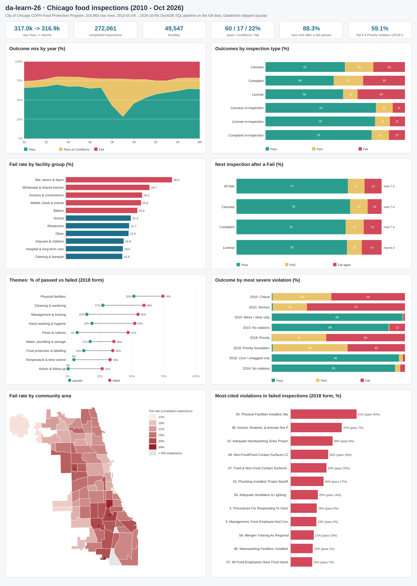

## Headline insights

1. **About one completed inspection in five fails, and that rate has barely moved in 16 years.** Of 272,061 completed inspections (2010-01-04 to 2026-10-09), 60.29% passed, 17.27% passed with conditions and 22.43% failed. Yearly fail rates stay between 19.62% and 25.91% (25.91% in 2010, 21.12% in 2025). What changed is the middle category: the new Food Code form of 1 July 2018 moved inspections from Pass to Pass w/ Conditions (2019: 28.33% pass, 49.26% with conditions), and the conditions share has since eased back to 14.2% (2025). Before vs after the switch: fail 22.18% vs 22.75%, conditions 10.93% vs 25.21%.
2. **The first visit is the risky one.** License inspections of new businesses fail 33.98%, complaint inspections 29.94%, routine canvass visits 22.62%, while re-inspections fail only 9.77%. Liquor task-force sweeps fail 56.85% (n = 920).
3. **Facility type matters more than the official risk category.** Bars, taverns and liquor stores fail 36.46%, wholesale / shared kitchens 28.71%, grocery and convenience stores 26.19%, restaurants 21.72%, and catering & banquet the least (19.39%). By risk category the order is reversed: Risk 1 (High) fails 21.83%, Risk 3 (Low) 29.05%. High-risk places are inspected far more often (7.85 completed inspections per facility vs 2.14); a likely reason for the reversal is that frequent routine visits keep high-risk kitchens prepared, while low-risk places are seen rarely.
4. **A clear South and West Side gap.** Among the 74 community areas with 500+ completed inspections, the fail rate runs from 33.52% in Washington Park and 30.78% in Greater Grand Crossing to 14.48% in Clearing and 13.35% at O’Hare. Of 57 ZIP codes with 1,000+ inspections, 60619 is highest (29.75%) and 60666 (O'Hare airport) lowest (12.39%). It is not just more complaint visits: the area fail rate tracks the fail rate of routine canvass visits (correlation 0.95; canvass fail rates range 12.27%-41.2%) more closely than the complaint share (0.533).
5. **Fails are usually fixed fast, but failure repeats.** 84.34% of fails get a follow-up within 14 days (median 7 days), and the next completed inspection passes 76.78% of the time (plus 11.49% with conditions); 11.73% fail again. Over the whole period 58.97% of inspected facilities failed at least once, 50.60% of those failed again, and 3,135 facilities (7.1%) failed five or more times, together 21,831 fails (35.8% of all fails).
6. **Pests, hand-wash sinks and serious-risk citations decide the outcome.** On the 2018 form an inspection with a Priority violation fails 59.12% of the time (the rest pass with conditions) and one with a Priority-foundation violation 43.08%, while core-only inspections fail 1.58%. Code 38 (insects, rodents and animals) appears in 47.08% of failed inspections vs 7.21% of passes, and 64.06% of inspections citing it fail; on the 2010 form code 18 (rodent proofing / pest log) was in 48.95% of fails and 97.49% of inspections citing it failed. Fail rates rise steadily with the number of violations (2018 form: 3.5% with none, 28.47% with five, 67.46% with 12 or more).
7. **Late summer is worst.** In full years 2010-2025 the fail rate peaks in Aug (24.09%) and is lowest in Dec (19.9%); the share of inspections citing pests rises from 11.95% (Dec) to 15.67% (Aug) and complaint-driven visits peak in July-August.
8. **Cleaning mattered.** 316,963 raw rows -> 316,851 distinct reports (112 exact duplicates with a different Inspection ID). 44,790 reports (Out of Business, No Entry, Not Ready, Business Not Located) are not inspection outcomes and are kept out of every rate. 3,647 fails carry no violation text, 1,061 reports have no coordinates, 118 city spellings of CHICAGO were fixed, and the Violations free text was split into 1,026,610 coded items joined to the right code list (2010 or 2018 form). 27/27 assertions pass.

## Q1 · Outcomes and trend

| Result | Reports | % of reports | % of completed |
|---|---|---|---|
| Pass | 164,039 | 51.77 | 60.29 |
| Pass w/ Conditions | 46,991 | 14.83 | 17.27 |
| Fail | 61,031 | 19.26 | 22.43 |
| Out of Business | 25,870 | 8.16 |  |
| No Entry | 14,199 | 4.48 |  |
| Not Ready | 4,625 | 1.46 |  |
| Business Not Located | 96 | 0.03 |  |

| Year | Completed | Pass % | Pass w/ cond. % | Fail % | Violations / insp. | Out of business | Facilities |
|---|---|---|---|---|---|---|---|
| 2010 | 17,363 | 65.88 | 8.21 | 25.91 | 3.13 | 673 | 10,658 |
| 2011 | 17,572 | 66.6 | 8.63 | 24.77 | 3.43 | 1,145 | 10,426 |
| 2012 | 16,015 | 67.71 | 9.56 | 22.73 | 3.56 | 2,583 | 10,500 |
| 2013 | 17,068 | 70.1 | 10.28 | 19.62 | 3.43 | 3,144 | 11,649 |
| 2014 | 18,619 | 67.62 | 12.4 | 19.97 | 3.59 | 2,145 | 11,460 |
| 2015 | 17,891 | 67.78 | 12.06 | 20.16 | 3.63 | 1,873 | 11,942 |
| 2016 | 19,858 | 65.1 | 13.26 | 21.64 | 3.41 | 1,543 | 12,115 |
| 2017 | 18,499 | 66.16 | 11.56 | 22.28 | 3.34 | 1,503 | 11,729 |
| 2018 | 14,849 | 42.91 | 34.75 | 22.34 | 4.41 | 1,193 | 9,982 |
| 2019 | 16,120 | 28.33 | 49.26 | 22.41 | 5.5 | 1,441 | 11,285 |
| 2020 | 12,600 | 45.52 | 31.18 | 23.29 | 4.32 | 1,398 | 8,686 |
| 2021 | 13,139 | 52.66 | 24.24 | 23.1 | 4.11 | 1,246 | 8,961 |
| 2022 | 14,284 | 57.6 | 17.52 | 24.87 | 3.81 | 1,277 | 9,701 |
| 2023 | 15,413 | 59.85 | 15.27 | 24.88 | 3.88 | 1,303 | 10,376 |
| 2024 | 15,995 | 61.94 | 16.29 | 21.76 | 3.76 | 1,436 | 11,120 |
| 2025 | 16,058 | 64.68 | 14.2 | 21.12 | 3.53 | 1,283 | 10,957 |
| 2026 | 10,718 | 64.08 | 14.6 | 21.32 | 3.39 | 684 | 7,556 |

2026 runs to 9 October (partial year).

| Inspection form | Completed | Pass % | Pass w/ cond. % | Fail % | Violations / insp. | No violation % |
|---|---|---|---|---|---|---|
| 2010 form (to 30 Jun 2018) | 151,181 | 66.9 | 10.93 | 22.18 | 3.44 | 16.66 |
| 2018 Food Code form (from 1 Jul 2018) | 120,880 | 52.04 | 25.21 | 22.75 | 4.15 | 16.74 |

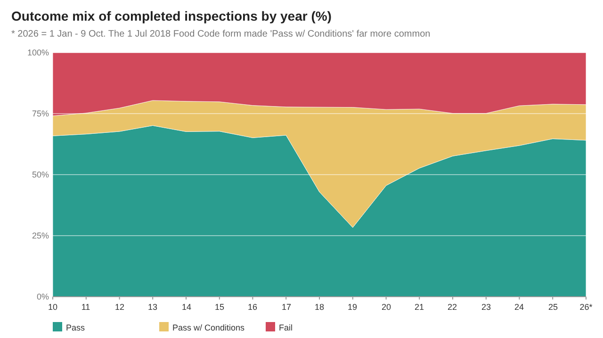
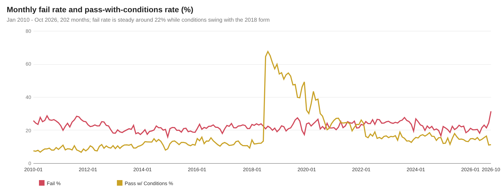

## Q2 · Facility types and risk

| Facility group | Completed | Facilities | Pass % | Pass w/ cond. % | Fail % | Violations / insp. |
|---|---|---|---|---|---|---|
| Unknown | 783 | 588 | 43.55 | 8.05 | 48.4 | 1.26 |
| Bar, tavern & liquor | 1,654 | 827 | 52.3 | 11.25 | 36.46 | 2.89 |
| Wholesale & shared kitchen | 930 | 375 | 65.91 | 5.38 | 28.71 | 2.54 |
| Grocery & convenience | 33,667 | 8,117 | 57.16 | 16.65 | 26.19 | 3.97 |
| Mobile, kiosk & events | 2,923 | 1,173 | 63.94 | 10.23 | 25.83 | 1.61 |
| Bakery | 3,976 | 657 | 59.51 | 15.95 | 24.55 | 4.31 |
| School | 19,887 | 1,313 | 68.25 | 9.44 | 22.31 | 2.83 |
| Restaurant | 184,827 | 27,188 | 59.18 | 19.1 | 21.72 | 3.99 |
| Other | 1,620 | 390 | 63.02 | 15.43 | 21.54 | 2.68 |
| Daycare & children | 15,089 | 2,301 | 69.08 | 11.08 | 19.84 | 2.53 |
| Hospital & long-term care | 4,750 | 864 | 64.57 | 15.85 | 19.58 | 3.09 |
| Catering & banquet | 1,955 | 355 | 64.96 | 15.65 | 19.39 | 3.34 |

| Risk | Completed | Facilities | Inspections / facility | Pass % | Pass w/ cond. % | Fail % |
|---|---|---|---|---|---|---|
| Risk 1 (High) | 206,841 | 26,362 | 7.85 | 60.5 | 17.67 | 21.83 |
| Risk 2 (Medium) | 47,485 | 9,661 | 4.92 | 59.83 | 17.61 | 22.55 |
| Risk 3 (Low) | 17,693 | 8,284 | 2.14 | 59.19 | 11.76 | 29.05 |
| Unknown / All | 42 | 37 | 1.14 | 35.71 | 0 | 64.29 |

| Facility type (raw, 500+) | Group | Completed | Fail % | Pass w/ cond. % |
|---|---|---|---|---|
| (blank) | Unknown | 783 | 48.4 | 8.05 |
| LIQUOR | Bar, tavern & liquor | 1,181 | 36.75 | 10.75 |
| WHOLESALE | Wholesale & shared kitchen | 543 | 36.65 | 2.21 |
| MOBILE FOOD DISPENSER | Mobile, kiosk & events | 892 | 30.27 | 4.37 |
| MOBILE FOOD PREPARER | Mobile, kiosk & events | 1,186 | 27.82 | 11.89 |
| DAYCARE COMBO 1586 | Daycare & children | 525 | 26.48 | 9.14 |
| GROCERY STORE | Grocery & convenience | 32,810 | 26.12 | 16.64 |
| BAKERY | Bakery | 3,920 | 24.62 | 15.99 |
| LONG TERM CARE | Hospital & long-term care | 2,300 | 24.61 | 17.48 |
| DAYCARE (2 - 6 YEARS) | Daycare & children | 2,800 | 22.39 | 7.93 |
| SCHOOL | School | 19,385 | 22.38 | 9.36 |
| RESTAURANT | Restaurant | 184,471 | 21.71 | 19.1 |
| DAYCARE ABOVE AND UNDER 2 YEARS | Daycare & children | 3,891 | 20.25 | 10.85 |
| CATERING | Catering & banquet | 1,562 | 18.57 | 15.94 |
| GOLDEN DINER | Hospital & long-term care | 844 | 18.25 | 12.32 |
| CHILDREN'S SERVICES FACILITY | Daycare & children | 7,305 | 18.07 | 12.64 |
| HOSPITAL | Hospital & long-term care | 953 | 16.37 | 15.84 |

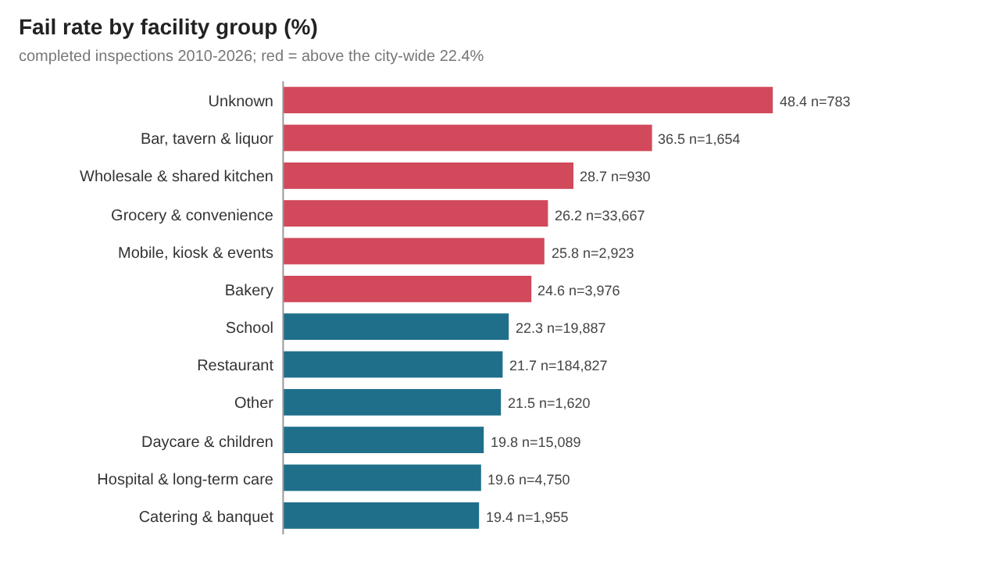
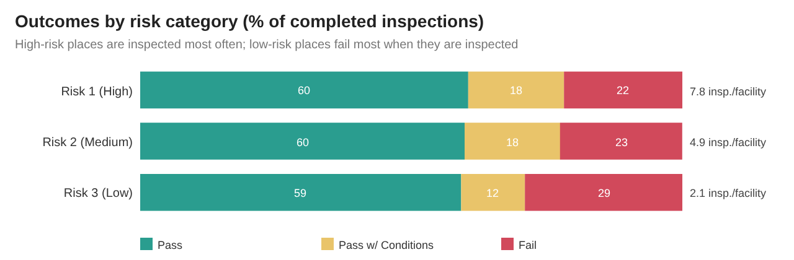
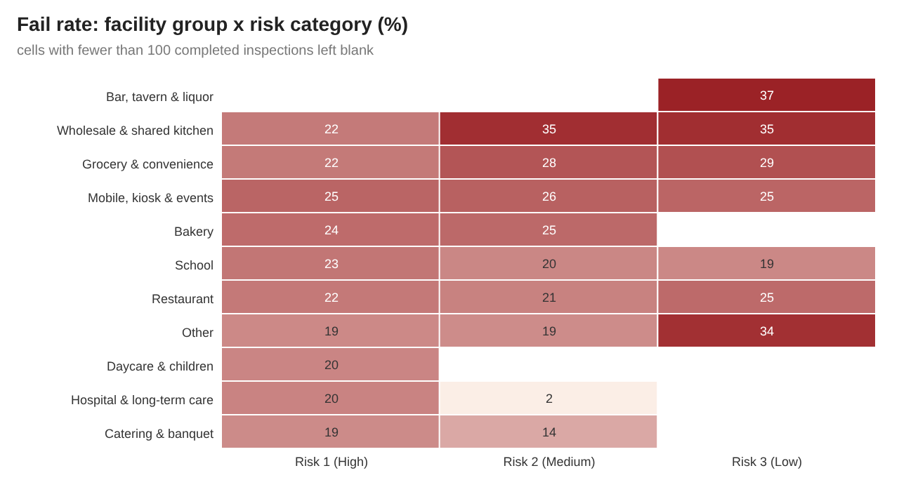

## Q3 · Geography

ZIP codes with at least 1,000 completed inspections (57), highest and lowest fail rates:

| Rank | ZIP | Completed | Fails | Fail % | Canvass fail % | Complaint share % | Facilities |
|---|---|---|---|---|---|---|---|
| 1 | 60619 | 5,362 | 1,595 | 29.75 | 32.78 | 31.6 | 886 |
| 2 | 60628 | 4,869 | 1,387 | 28.49 | 31.81 | 25 | 745 |
| 3 | 60620 | 5,191 | 1,468 | 28.28 | 30.57 | 28.9 | 802 |
| 4 | 60651 | 3,790 | 1,066 | 28.13 | 29.31 | 22.8 | 798 |
| 5 | 60636 | 3,087 | 866 | 28.05 | 32.09 | 30.5 | 536 |
| 6 | 60621 | 2,352 | 649 | 27.59 | 27.85 | 24.7 | 417 |
| 7 | 60644 | 3,265 | 887 | 27.17 | 27.43 | 23.8 | 590 |
| 8 | 60624 | 2,854 | 770 | 26.98 | 28.27 | 26.9 | 529 |
| 9 | 60639 | 7,216 | 1,923 | 26.65 | 28.64 | 19.4 | 1,215 |
| 10 | 60637 | 3,269 | 865 | 26.46 | 26.95 | 22.4 | 547 |
| 53 | 60604 | 1,677 | 260 | 15.5 | 15.72 | 14.3 | 251 |
| 54 | 60601 | 4,596 | 682 | 14.84 | 13.25 | 17.1 | 779 |
| 55 | 60638 | 3,756 | 552 | 14.7 | 11.48 | 15.6 | 534 |
| 56 | 60606 | 4,237 | 601 | 14.18 | 14.2 | 10.5 | 767 |
| 57 | 60666 | 3,842 | 476 | 12.39 | 12.37 | 7.7 | 407 |

Community areas with at least 500 completed inspections (74 of 77):

| Rank | Community area | Completed | Fail % | Canvass fail % | Complaint share % | Restaurant share % | Facilities |
|---|---|---|---|---|---|---|---|
| 1 | Washington Park | 913 | 33.52 | 41.2 | 33.4 | 43.3 | 139 |
| 2 | Greater Grand Crossing | 3,077 | 30.78 | 34.68 | 33.1 | 50 | 505 |
| 3 | Auburn Gresham | 3,170 | 29.78 | 33.68 | 23.2 | 46.5 | 543 |
| 4 | West Garfield Park | 1,370 | 29.71 | 34.2 | 28.8 | 45 | 305 |
| 5 | West Pullman | 1,265 | 29.09 | 31.94 | 22.5 | 35.4 | 202 |
| 6 | South Chicago | 2,104 | 28.85 | 29.02 | 21.8 | 39.2 | 326 |
| 7 | Roseland | 2,690 | 28.7 | 32.22 | 26.4 | 44.5 | 418 |
| 8 | West Englewood | 2,067 | 28.69 | 32.5 | 27.4 | 38.7 | 344 |
| 9 | Englewood | 2,007 | 28.45 | 28.19 | 21.2 | 32.8 | 384 |
| 10 | Chatham | 3,043 | 28.29 | 29.11 | 37.1 | 57.5 | 455 |
| 70 | Ashburn | 2,278 | 17.34 | 14.45 | 18.6 | 57.6 | 358 |
| 71 | Loop | 17,450 | 16.62 | 15.81 | 15.9 | 89.8 | 2,879 |
| 72 | Garfield Ridge | 3,016 | 15.68 | 12.27 | 15.6 | 74.9 | 440 |
| 73 | Clearing | 1,195 | 14.48 | 12.69 | 17.2 | 72.3 | 154 |
| 74 | Ohare | 4,456 | 13.35 | 13.19 | 7.7 | 86.7 | 539 |

Correlation across the 74 areas: fail % vs routine-canvass fail % = 0.95, fail % vs complaint share = 0.533.

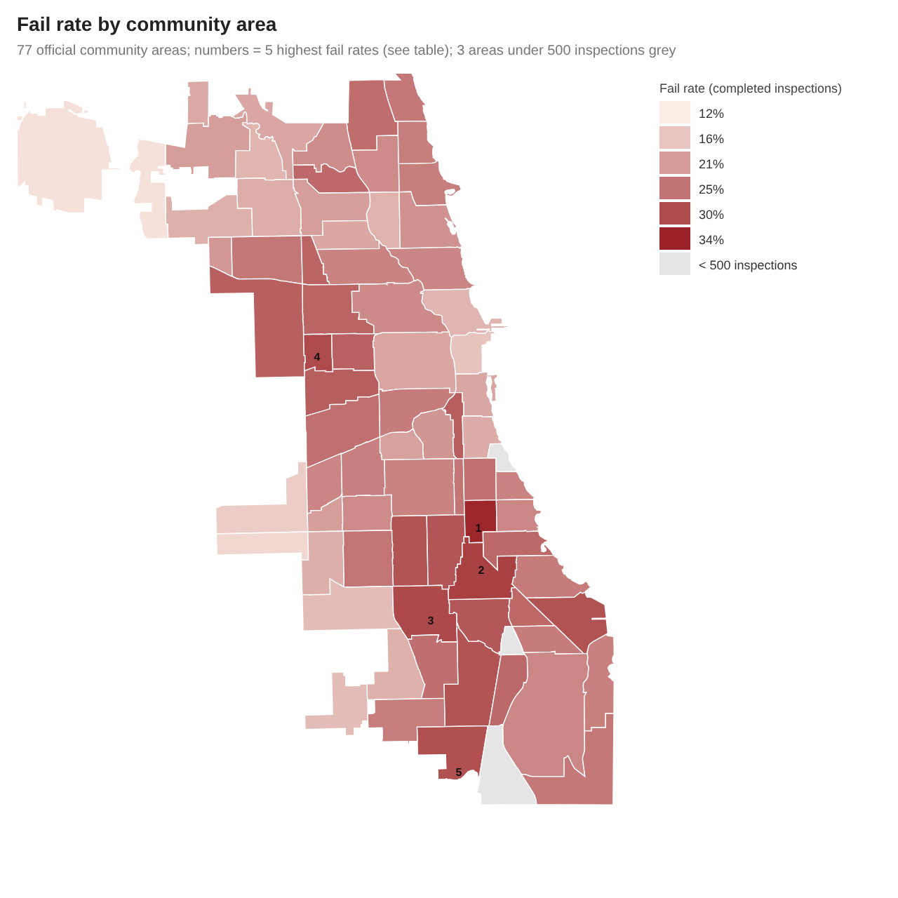
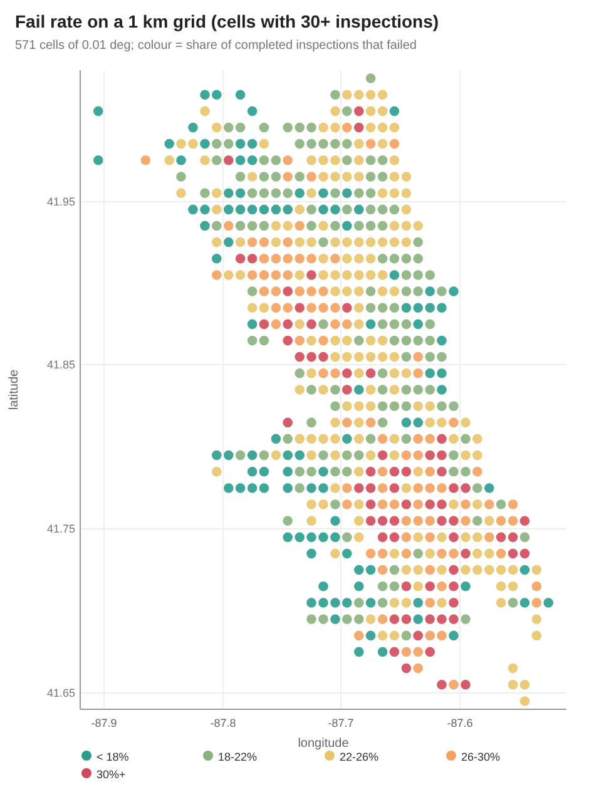
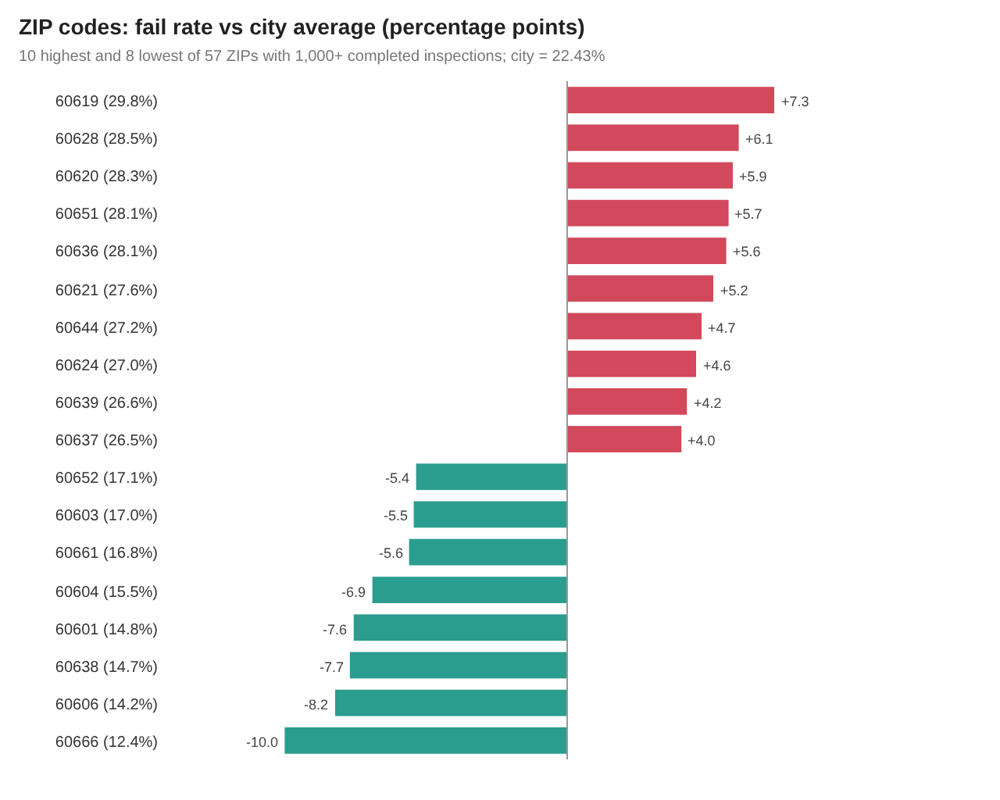

## Q4 · After a fail

| Failed inspection | Fails | With a next inspection | Next Pass % | Next PwC % | Next Fail % | Median days | Next within 30 d % | Next is a re-inspection % |
|---|---|---|---|---|---|---|---|---|
| All fails | 61,031 | 59,426 | 76.78 | 11.49 | 11.73 | 7 | 91.43 | 94.52 |
| Canvass | 29,971 | 29,387 | 78.32 | 12.1 | 9.58 | 7 | 95.02 | 97.22 |
| Complaint | 11,317 | 11,087 | 75.21 | 12.49 | 12.3 | 7 | 95.45 | 96.44 |
| License | 12,662 | 12,214 | 76.15 | 10.22 | 13.63 | 8 | 82.89 | 87.25 |
| Canvass re-inspection | 3,051 | 2,988 | 73.86 | 10.44 | 15.7 | 5 | 87.81 | 95.05 |
| Complaint re-inspection | 1,439 | 1,389 | 69.62 | 11.16 | 19.22 | 5 | 91.04 | 97.05 |
| License re-inspection | 1,382 | 1,325 | 76.38 | 8.91 | 14.72 | 7 | 86.47 | 97.58 |

| Days to next completed inspection | Fails | % of fails | Next passed (incl. PwC) % |
|---|---|---|---|
| 1 0-7 days | 32,867 | 53.85 | 88.85 |
| 2 8-14 days | 18,609 | 30.49 | 90.77 |
| 3 15-30 days | 4,323 | 7.08 | 85.31 |
| 4 31-90 days | 2,276 | 3.73 | 76.67 |
| 5 91-365 days | 1,104 | 1.81 | 69.2 |
| 6 over 1 year | 247 | 0.4 | 66.4 |
| 9 none yet / closed | 1,605 | 2.63 |  |

| Fails per facility | Facilities | % of inspected facilities | Fails | Avg completed inspections |
|---|---|---|---|---|
| 0 | 18,114 | 41.03 | 0 | 2.3 |
| 1 | 12,862 | 29.13 | 12,862 | 4.4 |
| 2 | 5,427 | 12.29 | 10,854 | 8.3 |
| 3 | 2,956 | 6.7 | 8,868 | 11.7 |
| 4 | 1,654 | 3.75 | 6,616 | 15 |
| 5+ | 3,135 | 7.1 | 21,831 | 22 |

| Rank | Facility | Address | Group | Completed | Fails | Fail % |
|---|---|---|---|---|---|---|
| 1 | ILLINOIS SPORTSERVICE, INC. | 333 W 35TH ST | Other | 185 | 35 | 18.9 |
| 2 | LAS ISLAS MARIAS | 4770 W GRAND AVE | Restaurant | 52 | 24 | 46.2 |
| 3 | LUIGI'S PIZZA BY THE SLICE, INC | 4212 W MADISON ST | Restaurant | 54 | 24 | 44.4 |
| 4 | LUMES PANCAKE HOUSE | 11601 S WESTERN AVE | Restaurant | 56 | 23 | 41.1 |
| 5 | CHAVEZ UPPER GRADE CENTER | 4831 S HERMITAGE | School | 61 | 22 | 36.1 |
| 6 | TAQUERIA EL RANCHITO | 2829 N MILWAUKEE AVE | Restaurant | 70 | 22 | 31.4 |
| 7 | POPEYE'S #831 | 1959 W HOWARD ST | Restaurant | 42 | 21 | 50 |
| 8 | IYANZE | 4623-4627 N BROADWAY | Restaurant | 51 | 21 | 41.2 |
| 9 | NEW HONG KONG BUFFET, INC | 6249 N MCCORMICK RD | Restaurant | 51 | 21 | 41.2 |
| 10 | A.P. DELI RESTAURANT GROUP, INC. | 10758 S MICHIGAN AVE | Restaurant | 46 | 20 | 43.5 |
| 11 | DEVON MARKET | 1440 W DEVON AVE | Grocery & convenience | 58 | 20 | 34.5 |
| 12 | MARIANO'S FRESH MARKET #8503 | 333 E BENTON PL | Grocery & convenience | 76 | 20 | 26.3 |
| 13 | DOG HAUS | 2464-2466 N LINCOLN AVE | Restaurant | 33 | 19 | 57.6 |
| 14 | MONTESSORI OF ENGLEWOOD | 6936 S HERMITAGE AVE | School | 38 | 19 | 50 |
| 15 | YUMMY BUFFET | 3921-3925 W LAWRENCE AVE | Restaurant | 46 | 19 | 41.3 |

Rank 1 is one license covering the concession stands at the White Sox ballpark (333 W 35th St), so it is inspected far more often than a single kitchen.

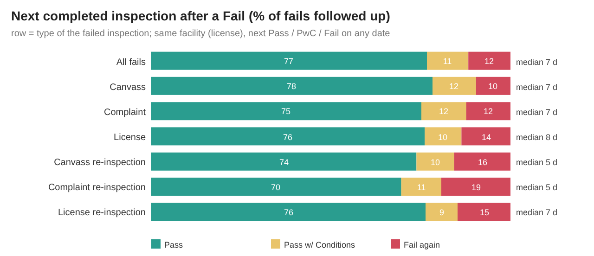
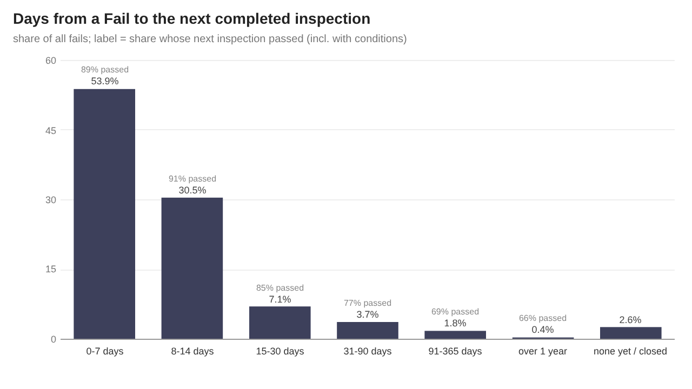
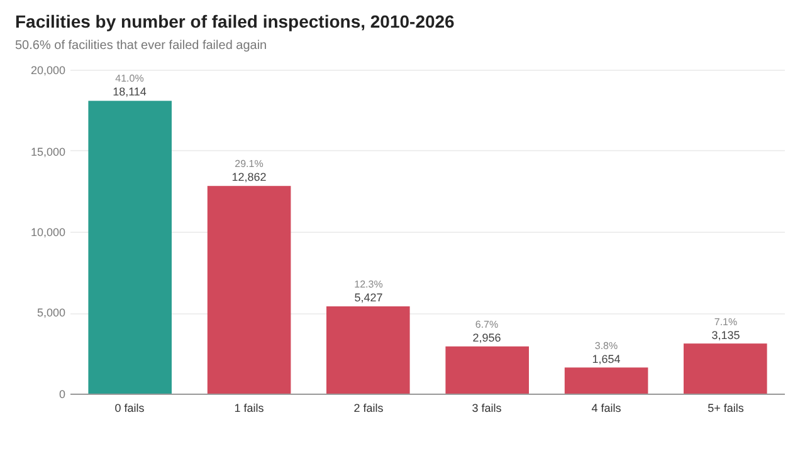
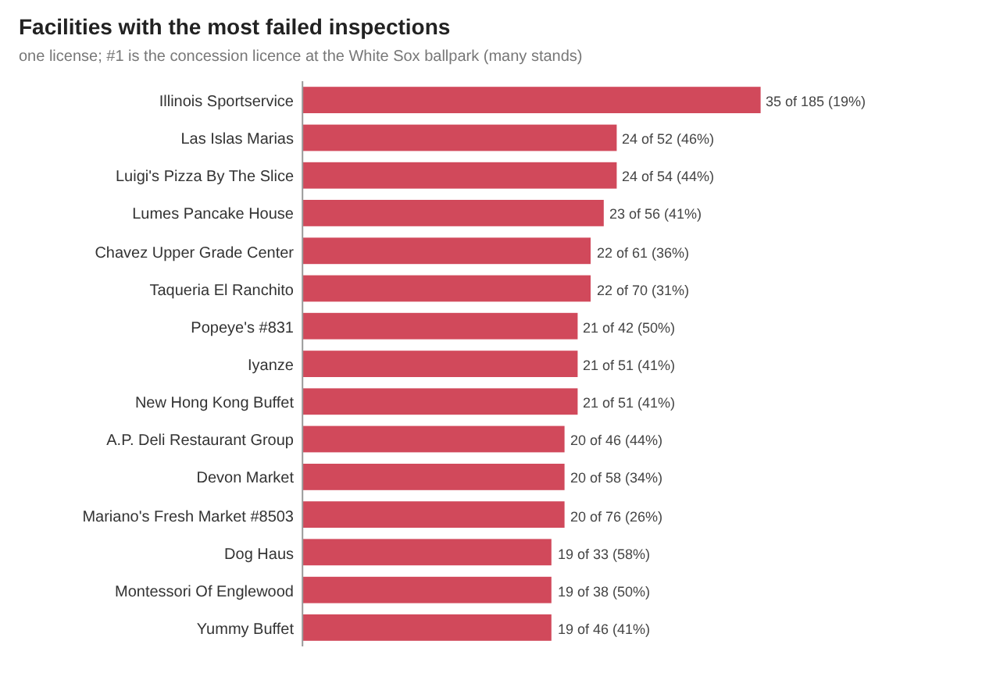

## Q5 · Violations behind failures

| Form | Most severe violation | Completed | Pass % | PwC % | Fail % | % of the form's fails |
|---|---|---|---|---|---|---|
| 2,010 | 1 Critical | 22,540 | 0.64 | 44.15 | 55.21 | 37.12 |
| 2,010 | 2 Serious | 23,339 | 0.88 | 25.55 | 73.56 | 51.21 |
| 2,010 | 3 Minor / other only | 80,118 | 98.22 | 0.56 | 1.22 | 2.91 |
| 2,010 | 4 No citations | 25,184 | 87.73 | 0.61 | 11.67 | 8.76 |
| 2,018 | 1 Priority | 15,437 | 0.28 | 40.6 | 59.12 | 33.18 |
| 2,018 | 2 Priority foundation | 39,332 | 0.81 | 56.11 | 43.08 | 61.61 |
| 2,018 | 3 Core / untagged only | 45,875 | 95.5 | 2.92 | 1.58 | 2.63 |
| 2,018 | 4 No citations | 20,236 | 92.56 | 3.94 | 3.5 | 2.58 |

| Form | Theme | Inspections citing | % of fails | % of PwC | % of passes | Fail / pass ratio |
|---|---|---|---|---|---|---|
| 2,010 | Physical facilities & maintenance | 117,693 | 84.41 | 87.03 | 74.17 | 1.14 |
| 2,010 | Cleaning & sanitizing | 68,882 | 57.38 | 57.33 | 39.72 | 1.44 |
| 2,010 | Pests & rodents | 17,422 | 50.6 | 2.2 | 0.09 | 550.31 |
| 2,010 | Food protection & labelling | 26,790 | 26.86 | 30.71 | 12.57 | 2.14 |
| 2,010 | Temperature & time control | 23,999 | 26.37 | 42.91 | 7.98 | 3.3 |
| 2,010 | Hand washing, hygiene & toilets | 15,026 | 23.33 | 23.07 | 3.36 | 6.95 |
| 2,010 | Administrative & follow-up | 9,075 | 21.01 | 12.04 | 0.04 | 505.94 |
| 2,010 | Management, certification & training | 16,045 | 16.68 | 36.22 | 4.42 | 3.77 |
| 2,010 | Water, plumbing & sewage | 2,407 | 5.81 | 2.74 | 0.01 | 979.42 |
| 2,018 | Physical facilities & maintenance | 72,380 | 74.25 | 64.1 | 51.55 | 1.44 |
| 2,018 | Cleaning & sanitizing | 46,206 | 59.48 | 41.59 | 27.3 | 2.18 |
| 2,018 | Management, certification & training | 46,612 | 54.82 | 73.11 | 14.71 | 3.73 |
| 2,018 | Hand washing, hygiene & toilets | 37,898 | 52.26 | 38.52 | 18.74 | 2.79 |
| 2,018 | Pests & rodents | 20,213 | 47.08 | 8.95 | 7.21 | 6.53 |
| 2,018 | Water, plumbing & sewage | 28,698 | 35.95 | 25.95 | 17.33 | 2.07 |
| 2,018 | Food protection & labelling | 26,618 | 35.07 | 30.24 | 12.33 | 2.84 |
| 2,018 | Temperature & time control | 22,271 | 32.97 | 33.79 | 4.62 | 7.14 |
| 2,018 | Administrative & follow-up | 10,547 | 26.78 | 10.1 | 0.16 | 166.81 |

| Form | Rank | Code | Title | Class | % of fails | % of passes | Fail % when cited |
|---|---|---|---|---|---|---|---|
| 2,010 | 1 | 34 | FLOORS: CONSTRUCTED PER CODE, CLEANED, GOOD REPAIR, COVING INSTALLED, DUST-LESS CLEANING METHODS USED | Minor | 56.81 | 42.3 | 27 |
| 2,010 | 2 | 35 | WALLS, CEILINGS, ATTACHED EQUIPMENT CONSTRUCTED PER CODE: GOOD REPAIR, SURFACES CLEAN AND DUST-LESS CLEANING METHODS | Minor | 53.25 | 37.62 | 28.13 |
| 2,010 | 3 | 18 | NO EVIDENCE OF RODENT OR INSECT OUTER OPENINGS PROTECTED/RODENT PROOFED, A WRITTEN LOG SHALL BE MAINTAINED AVAILABLE TO THE INSPECTORS | Serious | 48.95 | 0.09 | 97.49 |
| 2,010 | 4 | 33 | FOOD AND NON-FOOD CONTACT EQUIPMENT UTENSILS CLEAN, FREE OF ABRASIVE DETERGENTS | Minor | 48.33 | 37.06 | 26.2 |
| 2,010 | 5 | 38 | VENTILATION: ROOMS AND EQUIPMENT VENTED AS REQUIRED: PLUMBING: INSTALLED AND MAINTAINED | Minor | 45.21 | 30.97 | 28.69 |
| 2,010 | 6 | 32 | FOOD AND NON-FOOD CONTACT SURFACES PROPERLY DESIGNED, CONSTRUCTED AND MAINTAINED | Minor | 43.25 | 30.99 | 27.4 |
| 2,010 | 7 | 41 | PREMISES MAINTAINED FREE OF LITTER, UNNECESSARY ARTICLES, CLEANING EQUIPMENT PROPERLY STORED | Minor | 31.58 | 18.18 | 32.11 |
| 2,010 | 8 | 36 | LIGHTING: REQUIRED MINIMUM FOOT-CANDLES OF LIGHT PROVIDED, FIXTURES SHIELDED | Minor | 23 | 14.57 | 30.28 |
| 2,010 | 9 | 29 | PREVIOUS MINOR VIOLATION(S) CORRECTED 7-42-090 | Serious | 16.54 | 0.03 | 91.7 |
| 2,010 | 10 | 40 | REFRIGERATION AND METAL STEM THERMOMETERS PROVIDED AND CONSPICUOUS | Minor | 13.79 | 7.91 | 31.02 |
| 2,010 | 11 | 30 | FOOD IN ORIGINAL CONTAINER, PROPERLY LABELED: CUSTOMER ADVISORY POSTED AS NEEDED | Minor | 12.55 | 9.22 | 25.99 |
| 2,010 | 12 | 21 | * CERTIFIED FOOD MANAGER ON SITE WHEN POTENTIALLY HAZARDOUS FOODS ARE PREPARED AND SERVED | Serious | 12.11 | 0.04 | 43.49 |
| 2,010 | 13 | 19 | OUTSIDE GARBAGE WASTE GREASE AND STORAGE AREA; CLEAN, RODENT PROOF, ALL CONTAINERS COVERED | Serious | 11.59 | 0.01 | 91.5 |
| 2,010 | 14 | 16 | FOOD PROTECTED DURING STORAGE, PREPARATION, DISPLAY, SERVICE AND TRANSPORTATION | Serious | 11.12 | 0.03 | 72.26 |
| 2,010 | 15 | 3 | POTENTIALLY HAZARDOUS FOOD MEETS TEMPERATURE REQUIREMENT DURING STORAGE, PREPARATION DISPLAY AND SERVICE | Critical | 10.89 | 0.02 | 40.46 |
| 2,018 | 1 | 55 | PHYSICAL FACILITIES INSTALLED, MAINTAINED & CLEAN | Good retail practice | 60.8 | 39.94 | 29.23 |
| 2,018 | 2 | 38 | INSECTS, RODENTS, & ANIMALS NOT PRESENT | Good retail practice | 47.08 | 7.21 | 64.06 |
| 2,018 | 3 | 10 | ADEQUATE HANDWASHING SINKS PROPERLY SUPPLIED AND ACCESSIBLE | Risk factor / public health intervention | 38.68 | 7.77 | 46.68 |
| 2,018 | 4 | 49 | NON-FOOD/FOOD CONTACT SURFACES CLEAN | Good retail practice | 34.55 | 18.83 | 33.21 |
| 2,018 | 5 | 47 | FOOD & NON-FOOD CONTACT SURFACES CLEANABLE, PROPERLY DESIGNED, CONSTRUCTED & USED | Good retail practice | 33 | 20 | 29.96 |
| 2,018 | 6 | 51 | PLUMBING INSTALLED; PROPER BACKFLOW DEVICES | Good retail practice | 30.31 | 16.73 | 31.76 |
| 2,018 | 7 | 56 | ADEQUATE VENTILATION & LIGHTING; DESIGNATED AREAS USED | Good retail practice | 25.06 | 13.56 | 31.88 |
| 2,018 | 8 | 5 | PROCEDURES FOR RESPONDING TO VOMITING AND DIARRHEAL EVENTS | Risk factor / public health intervention | 24.04 | 0.22 | 34.29 |
| 2,018 | 9 | 3 | MANAGEMENT, FOOD EMPLOYEE AND CONDITIONAL EMPLOYEE; KNOWLEDGE, RESPONSIBILITIES AND REPORTING | Risk factor / public health intervention | 23.66 | 0.16 | 35.24 |
| 2,018 | 10 | 58 | ALLERGEN TRAINING AS REQUIRED | Good retail practice | 21.29 | 9.63 | 28.84 |
| 2,018 | 11 | 48 | WAREWASHING FACILITIES: INSTALLED, MAINTAINED & USED; TEST STRIPS | Good retail practice | 20.33 | 1.4 | 67.36 |
| 2,018 | 12 | 57 | ALL FOOD EMPLOYEES HAVE FOOD HANDLER TRAINING | Good retail practice | 19.87 | 7.16 | 35.58 |
| 2,018 | 13 | 53 | TOILET FACILITIES: PROPERLY CONSTRUCTED, SUPPLIED, & CLEANED | Good retail practice | 19.68 | 10.05 | 33.37 |
| 2,018 | 14 | 2 | CITY OF CHICAGO FOOD SERVICE SANITATION CERTIFICATE | Risk factor / public health intervention | 18.12 | 0.03 | 46.04 |
| 2,018 | 15 | 60 | PREVIOUS CORE VIOLATION CORRECTED | Administrative | 18.08 | 0.02 | 76.02 |

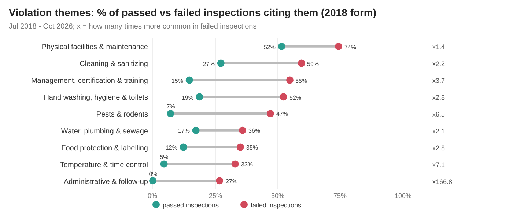
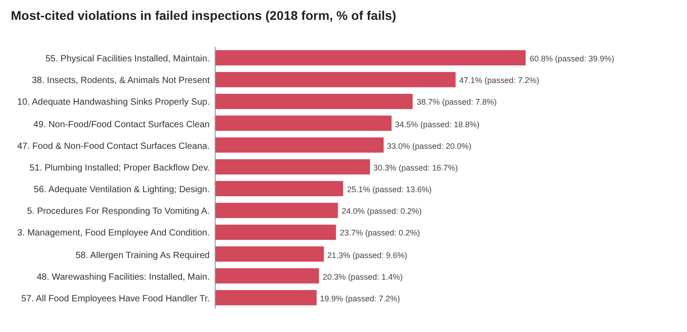
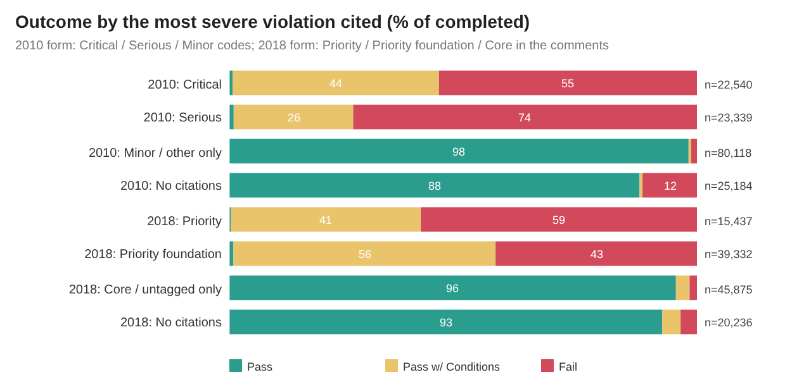
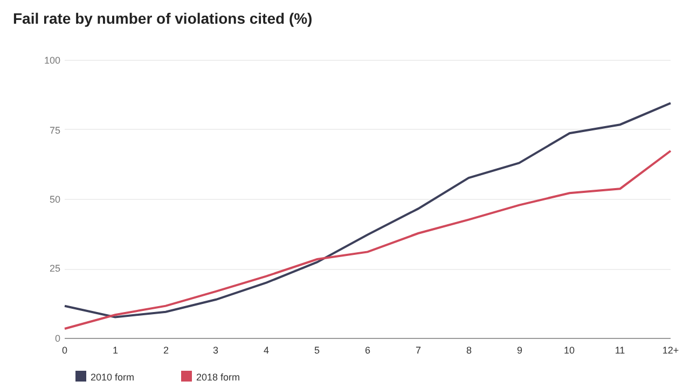

## Q6 · Inspection programmes

| Inspection type | Completed | Share % | Pass % | PwC % | Fail % | Violations / insp. |
|---|---|---|---|---|---|---|
| Canvass | 132,470 | 48.69 | 56.88 | 20.49 | 22.62 | 4.27 |
| Complaint | 37,795 | 13.89 | 48.87 | 21.19 | 29.94 | 4.83 |
| License | 37,267 | 13.7 | 55.63 | 10.4 | 33.98 | 2.89 |
| Canvass re-inspection | 34,851 | 12.81 | 79.17 | 12.07 | 8.75 | 2.68 |
| License re-inspection | 12,732 | 4.68 | 78.53 | 10.62 | 10.85 | 1.52 |
| Complaint re-inspection | 12,498 | 4.59 | 76.08 | 12.41 | 11.51 | 3.03 |
| Other | 2,272 | 0.84 | 59.9 | 22.49 | 17.61 | 2.54 |
| Suspected food poisoning | 1,020 | 0.37 | 42.94 | 30.88 | 26.18 | 5.25 |
| Task force / liquor | 920 | 0.34 | 43.04 | 0.11 | 56.85 | 2.34 |
| Suspected food poisoning re-inspection | 230 | 0.08 | 83.48 | 9.57 | 6.96 | 2.94 |

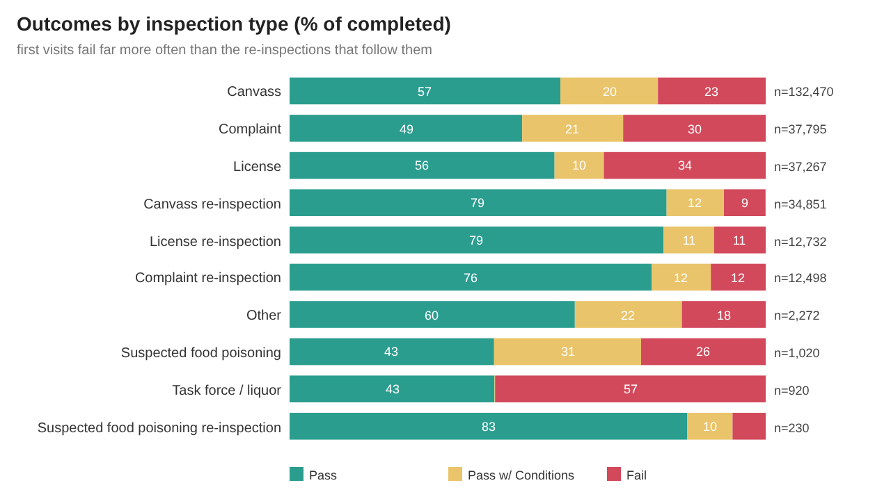
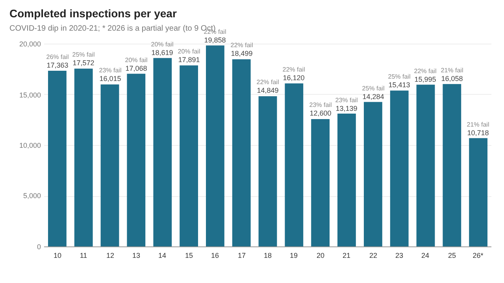

## Seasonality

| Month | Completed per year | Fail % | Citing pests % | Complaint share % |
|---|---|---|---|---|
| Jan | 1,283.8 | 22.45 | 12.13 | 18.11 |
| Feb | 1,206.3 | 22.59 | 12.66 | 19.03 |
| Mar | 1,464.6 | 22.06 | 12.69 | 17.12 |
| Apr | 1,425.4 | 22.44 | 13.36 | 16.7 |
| May | 1,502.9 | 22.02 | 13.32 | 15.65 |
| Jun | 1,465.1 | 22.78 | 13.6 | 16.36 |
| Jul | 1,237.3 | 23.3 | 14.49 | 21.14 |
| Aug | 1,425.5 | 24.09 | 15.67 | 21.9 |
| Sep | 1,440.9 | 23.39 | 15.01 | 19.7 |
| Oct | 1,487.2 | 22.78 | 15.05 | 19.1 |
| Nov | 1,258 | 21.42 | 13.23 | 17.29 |
| Dec | 1,136.9 | 19.9 | 11.95 | 18.39 |

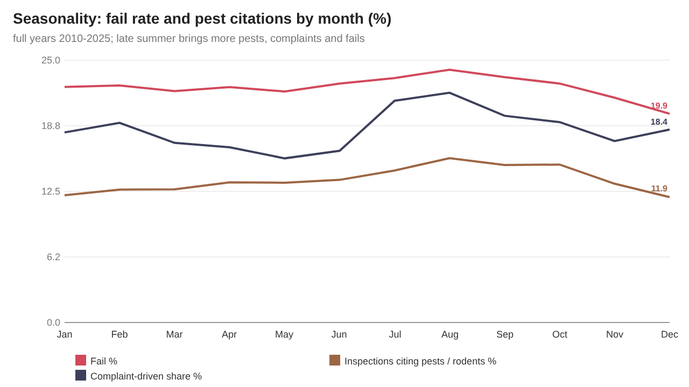

## Q7 · Data quality

| Entity | Raw rows | Distinct | Clean | Grain |
|---|---|---|---|---|
| agg_area_year |  |  | 1,326 | community area x year |
| agg_facility_year |  |  | 203,133 | facility x year |
| agg_zip_month |  |  | 11,914 | ZIP x month |
| completed inspections (Pass / Pass w/ Conditions / Fail) |  |  | 272,061 | inspection |
| dim_community_area (77 + unknown) |  |  | 78 | community area |
| dim_date |  |  | 6,126 | day, 2010-01-01 .. last inspection |
| dim_facility |  |  | 49,547 | license number (or name + address when no license) |
| dim_inspection_type |  |  | 99 | standardised inspection type |
| dim_result / dim_risk |  |  | 12 | 8 + 4 |
| dim_violation |  |  | 110 | code on the 2010 form or the 2018 form |
| raw inspection rows (food_inspections.csv) | 316,963 | 316,851 | 316,851 | inspection report (clean = fact_inspection) |
| reports without an outcome (Out of Business, No Entry, Not Ready, Not Located) |  |  | 44,790 | report |
| violation items parsed from the Violations text (fact_violation) |  |  | 1,026,610 | cited violation |

| Raw column | Blank % | Treatment |
|---|---|---|
| AKA Name | 0.77 | optional trading name |
| City | 0.06 | imputed CHICAGO when the ZIP is a Chicago ZIP |
| Facility Type | 1.69 | kept, facility_group = Unknown |
| Inspection ID / DBA Name / Inspection Date / Results | 0 | required: never empty |
| Latitude / Longitude | 0.33 | not geocoded: kept, community area 0 (unknown) |
| License # | 0.27 | blank or 0: facility keyed by name + address instead |
| Risk (blank or All) | 0.05 | kept, risk_key = 0 (Unknown / All) |
| Violations | 28.21 | no violation cited (normal for clean passes and non-inspections) |
| Zip | 0.01 | kept, left out of the ZIP ranking |

| Issue | Rows |
|---|---|
| Fail with no violation text | 3,647 |
| ZIP blank | 42 |
| ZIP outside Chicago, kept + flagged | 270 |
| address outside Chicago (suburb city name), kept + flagged | 280 |
| blank city imputed CHICAGO from a Chicago ZIP | 144 |
| city misspellings of CHICAGO fixed (CCHICAGO, CHICAGOO, 312CHICAGO, ...) | 118 |
| city still blank | 38 |
| code list switch: inspections on the 2018 Food Code form (from 1 Jul 2018) | 144,068 |
| exact duplicate reports (identical except Inspection ID), dropped | 112 |
| facility-type spellings merged by upper-casing / trimming | 55 |
| geocoded but outside all 77 community areas | 324 |
| inspection-type spellings merged by upper-casing / trimming | 12 |
| licenses seen at more than one address | 343 |
| licenses seen with more than one business name (ownership / name changes) | 1,249 |
| missing facility type | 5,344 |
| missing license number (blank or 0), keyed by name + address | 850 |
| not geocoded (no latitude / longitude) | 1,061 |
| risk blank or All, risk_key 0 | 174 |
| same facility + day + type + result but different content (possible duplicates), kept + listed | 691 |
| same violation code cited more than once in one inspection (extra items) | 65,139 |
| violations recorded on a report without an outcome (Out of Business, No Entry ...) | 907 |

### Assertions: 27/27 pass

| Check | Failed rows | Status |
|---|---|---|
| >= 99% of geocoded reports fall inside a community area [full data only] | 0 | PASS |
| Inspection ID unique in raw and in fact_inspection | 0 | PASS |
| a_after_fail All fails = every completed Fail | 0 | PASS |
| a_repeat_fail covers every inspected facility | 0 | PASS |
| a_yearly: pass + conditions + fail = completed, totals = w_base | 0 | PASS |
| agg_area_year and agg_facility_year sum back to fact_inspection | 0 | PASS |
| agg_zip_month sums back to fact_inspection (reports, completed, fails) | 0 | PASS |
| all 77 community areas have completed inspections, >= 70 ranked (>= 500) [full data only] | 0 | PASS |
| citation levels (Priority / PF / Core) only on 2018-form items | 0 | PASS |
| completed + not inspected = all reports and completed shares sum to 100% | 0 | PASS |
| dim_date is gap-free from 1 Jan of the first year to the last inspection | 0 | PASS |
| dim_facility totals = fact_inspection (reports, completed, fails) | 0 | PASS |
| distinct reports = raw rows - exact duplicates | 0 | PASS |
| every full year 2010-2025 has >= 10,000 completed inspections [full data only] | 0 | PASS |
| every inspection date parsed and not after the snapshot | 0 | PASS |
| every result is one of the 7 published values | 0 | PASS |
| every violation item parsed to a code known on its form (2010: 1-45, 70; 2018: 1-64) | 0 | PASS |
| facility_key and facility_id unique in dim_facility | 0 | PASS |
| fact keys exist in every dimension (RI) | 0 | PASS |
| fact_inspection = cln_inspections (no report lost in joins) | 0 | PASS |
| geocoded points inside the Chicago box (lat 41.6-42.1, lng -87.95..-87.5) | 0 | PASS |
| names and addresses standardised (upper case, trimmed, single spaces) | 0 | PASS |
| next / previous completed inspection is never earlier (days >= 0) | 0 | PASS |
| no CHICAGO misspelling left in city | 0 | PASS |
| per-inspection citation counts sum to fact_violation | 0 | PASS |
| risk_key in 0..3, facility_group and type_group never null | 0 | PASS |
| violation items = items in the raw text (split on /) | 0 | PASS |

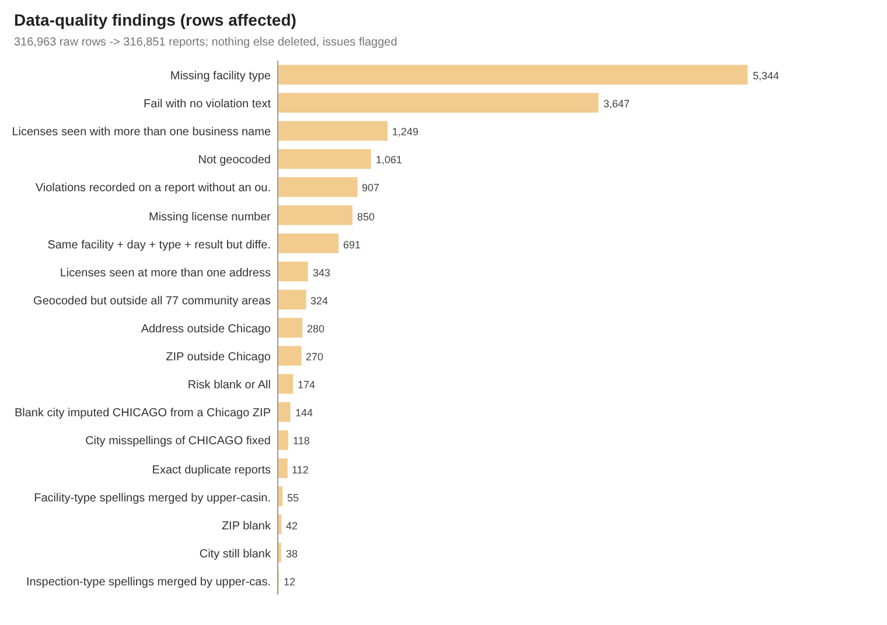

## How the images were made

`scripts/make_charts.py` reads the DuckDB result tables in `results/tables/*.csv` and writes every chart as a plain-vector SVG with the small custom writer `scripts/svgcharts.py` (rect / line / polyline / polygon / circle / text only, no plotting library, no embedded raster). The community-area map draws the 77 official boundaries (simplified in `data/reference/community_area_shapes.json`) as SVG polygons. `scripts/render_png.py` then rasterises each SVG to PNG at 2x with headless Google Chrome.
